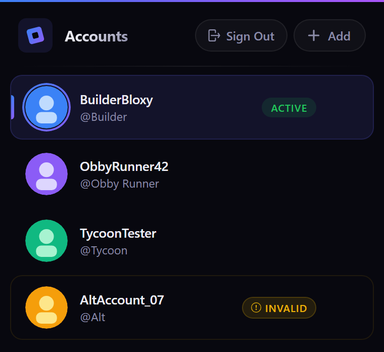

# Roblox Account Switcher

A small Chrome extension for switching between your Roblox accounts in one click, with no logging out, no retyping passwords and no 2-step codes every time.

<p align="center">
  
</p>

<sub>Screenshot uses made-up demo accounts.</sub>

## Features

- **One-click switching.** Click a saved account and the open Roblox tab reloads, signed in as that account.
- **Add the current account.** Log in on roblox.com, open the popup, press **Add**. Username, display name and avatar are filled in automatically.
- **Knows which account is active.** It checks your Roblox user ID rather than the raw cookie, so it stays correct when Roblox refreshes your session in the background, and it saves the refreshed session for you.
- **Session health check.** When Chrome starts, each saved account is checked against Roblox. Expired or logged-out sessions get an **Invalid** badge, and avatars are refreshed. Your current login is restored afterwards.
- **Sign Out** removes the login from the browser without forgetting the account, so you can switch back later.
- **Remove** an account (with a confirm step) to delete it from the extension.
- Manifest V3, no build step, no dependencies, no tracking.

## Install

The extension isn't on the Chrome Web Store, so you load it yourself (takes a minute):

1. Download this repo: **Code > Download ZIP** and unzip it, or `git clone https://github.com/sombolian/roblox-account-switcher.git`.
2. Open `chrome://extensions` in Chrome (or any Chromium browser: Edge, Brave, Opera).
3. Turn on **Developer mode** (top right).
4. Click **Load unpacked** and pick the folder that contains `manifest.json`.
5. Pin the extension from the puzzle-piece menu so it's one click away.

To update, replace the folder with the new version and press the reload button on the extension's card in `chrome://extensions`. Your saved accounts are kept.

## Usage

1. Log in to an account on [roblox.com](https://www.roblox.com).
2. Open the extension and press **Add**.
3. To add another account, press **Sign Out**, log in to the next account on roblox.com, and press **Add** again.
4. From then on, click any account in the list to switch to it.

> [!TIP]
> Use **Sign Out** in the extension, not Roblox's own **Log Out**, when adding more accounts. Roblox's Log Out ends that session on Roblox's side, so the saved account would show as **Invalid** and need adding again.

## How it works

Roblox keeps you signed in with a cookie called `.ROBLOSECURITY`. When you press **Add**, the extension saves a copy of that cookie together with the account's name, ID and avatar. Switching puts the saved cookie back into the browser and reloads the page.

| Permission | Why it's needed |
|---|---|
| `cookies` + access to `*.roblox.com` | read and set the Roblox login cookie, and ask Roblox which account is signed in |
| `storage` | keep your saved accounts in the browser |

The extension only ever talks to Roblox's own servers (`users.roblox.com` for the signed-in user, `thumbnails.roblox.com` for avatars). It has no server of its own and sends your data nowhere else.

## Security

Read this before using any account switcher:

- **A saved account is a full login.** Anyone who gets the `.ROBLOSECURITY` value can use the account without the password or 2-step verification.
- Accounts are stored **unencrypted** in Chrome's extension storage, on your computer only. Malware, other people using your Chrome profile, or a malicious extension with access to this extension's storage could read them. Only use it on a computer you trust.
- **Sign Out** and **Remove** only affect your browser. The session itself stays valid on Roblox. To cut off a session for real, use **Settings > Security > Log out of all other sessions** on roblox.com.
- Never paste your cookie anywhere, and be wary of any "account manager" that asks for it. This extension never asks; it reads it directly from the browser.

## Project layout

```
manifest.json         extension manifest (MV3)
background.js         service worker: cookie read/write and the startup session check
popup.html/css/js     the popup UI
icons/                toolbar and store icons
gen-icons.js          regenerates icons/ with Node:  node gen-icons.js
generate-icons.html   browser alternative: open it to download the icons
docs/screenshot.png   README screenshot
```

## Disclaimer

This is an independent fan project. It is not made, endorsed or supported by Roblox Corporation. "Roblox" is a trademark of Roblox Corporation. Use it at your own risk.

## License

[MIT](LICENSE)
